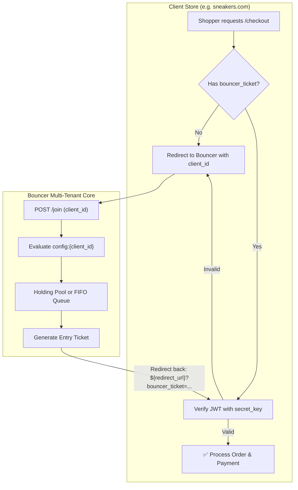

# Current Progress

This file is the single source of truth for Project Bouncer and the order of work. Bouncer is a multi-tenant B2B SaaS platform ("Waiting Room as a Service" / "Digital Dam") that sits in front of client websites during high-demand traffic spikes, protecting checkouts from crashing and neutralizing scalper bots.

---

## 1. Role Boundaries: Admin vs. Client

To keep clear architectural boundaries, user management belongs entirely to the client, while client management belongs to the admin.

### A. The Client (Store Owner / E-commerce Merchant)
* **Who they are:** The business running a drop (e.g. Nike, Ticketmaster, concert promoter).
* **What they own:** Their shoppers, their drop configuration, and their traffic.
* **Client Dashboard (`/dashboard`) responsibilities:**
  - **Drop Configuration:** Sets target `redirect_url` (where cleared shoppers return to checkout), `allowed_origins`, `start_time`, `auto_start` toggle (automated at start time vs manual Go Live), and `process_rate` (clearance speed in users/sec).
  - **Drop Controls:** 
    - **Go Live:** Manually trigger the Grand Shuffle and open the drop whenever ready.
    - **Emergency Flush:** Flush **only their own** queue (`queue:{client_id}:*`) if they need to reset their drop. A client can never flush another client's users.
  - **Live Metrics:** Real-time metrics for their drop:
    - Shoppers in Holding Pool (`lottery_pool:{client_id}`).
    - Shoppers waiting in line (`queue:{client_id}:auth_queue` / `fast_lane`).
    - Blocked Bots & Scalpers rejected by Tier 2 WAF (`metrics:{client_id}:rejected_bots`).
    - Total Admitted Users redirected to checkout (`metrics:{client_id}:admitted_users`).
  - **API Keys & Integration:** View public `client_id`, private `secret_key`, and copy-paste SDK snippets.

### B. The Admin (Bouncer Platform Operator)
* **Who they are:** The internal operator of the Bouncer infrastructure.
* **What they own:** Platform health, subscribed client accounts, and tenant oversight.
* **Admin Dashboard (`/admin`) responsibilities:**
  - **Client Overview:** Total number of subscribed clients.
  - **Tier Distribution:** Breakdown showing how many clients are using Tier 1, Tier 2, Tier 3, etc.
  - **Subscribed Clients Table:** Lists all registered clients, their tier mix, their website/redirect URL, drop status (`Idle`, `Scheduled`, or `Live`), and active shoppers on their site.
  - **What Admin does NOT do:**
    - Admin **does not flush queues** (queue flushes belong exclusively to the client for their own site).
    - Admin **does not monitor raw shopper queues** (global `auth_queue` and `fast_lane` are removed; all queues are partitioned per client).

---

## 2. The Tier Architecture (Core Engines & Future Expansions)

Tiers are independent, modular add-on capabilities, not a rigid ladder. A client can purchase any non-empty combination (e.g. Tier 2 only, Tier 1 + 3, or all tiers).

### Existing Core Tiers

* **Tier 1: High-Concurrency Core (The Digital Dam)**
  - FIFO waiting room with real-time WebSocket position decrementing.
  - Workers release shoppers at a metered `process_rate` to protect the store's database from overload.
  - Fast-pass queue for shoppers who pre-authenticated up to 48 hours prior.
  - Issues HMAC-SHA256 signed entry tickets back to checkout.
* **Tier 2: Anti-Bot WAF (The Shield)**
  - Headless scraper signature blocking (`python-requests`, `curl`, `puppeteer`, etc.).
  - Real browser context enforcement (`sec-fetch-mode`).
  - Sliding-window IP rate limiting.
  - Tracks rejected bot count (`metrics:{client_id}:rejected_bots`).
  - If bought without Tier 1: cleans traffic and issues immediate tickets without a waiting line.
* **Tier 3: Intent & Lottery (The Scalper Killer)**
  - Cryptographic Pre-Cart Intent JWT with single-use nonce (`jti`) replay defense.
  - Pre-drop unordered holding pool (`lottery_pool:{client_id}`) neutralizing time-based bot camping.
  - The Grand Shuffle: at Go-Live, scrambles holding pool users before queue entry or release.

### New Tier Concepts (Solving Real-World Web & Application Crashes)

* **Tier 4: Proof-of-Human Behavioral Engine (AI Bot Buster)**
  - *Problem:* Advanced bots use stealth headless browsers (e.g. undetected-chromedriver) to forge browser headers and pass basic WAFs.
  - *Solution:* In-browser zero-knowledge Proof-of-Work (PoW) computational challenge or behavioral entropy check (mouse velocity, touch/gyro kinematics, canvas fingerprinting) required before a queue position or entry ticket is issued.
* **Tier 5: Dynamic Dam (Auto-Sensing Flow Control)**
  - *Problem:* Setting a static `process_rate` (e.g. 50/sec) can still crash a client site if payment providers (Stripe/PayPal) or database queries suddenly slow down.
  - *Solution:* Bouncer periodically pings client backend health/latency (`/health` or checkout response time). If client server latency exceeds 800ms, Bouncer automatically downshifts clearance rate (e.g. from 50/sec to 10/sec) until the site recovers, preventing 502/504 Bad Gateway crashes.
* **Tier 6: Geofencing & Datacenter ASN Blocking**
  - *Problem:* Scalpers run automated scripts on cheap cloud instances (AWS, GCP, DigitalOcean, Hetzner, OVH) and from foreign countries.
  - *Solution:* Autonomous IP intelligence that blocks requests originating from cloud hosting ASNs while permitting only residential ISP connections, plus country/state geofencing for regional ticket events.

---

## 3. How Clients Connect Their Website to Bouncer

1. **Client Configuration:**
   Client stores their `CLIENT_ID` and private `SHARED_SECRET` on their backend.
2. **Shopper Redirection:**
   When traffic exceeds safe threshold or drop starts, client redirects shoppers to:
   `https://bouncer.app/?client_id=org_123`
   Bouncer uses the client's configured `redirect_url` stored in `config:{client_id}`.
3. **Queue / Lottery Clearance:**
   Bouncer manages the spike in memory. When a shopper is cleared, Bouncer redirects them to:
   `${redirect_url}?bouncer_ticket=${signed_jwt}`
4. **Authenticity Check:**
   Client backend verifies the ticket using their private `SHARED_SECRET` via HMAC-SHA256. If valid, order proceeds.

---

## 4. Current Progress Matched to Code

- **Done:**
  - FIFO lanes, WebSocket connection manager, ticket signing, workers, Tier 2 WAF, Tier 3 Pre-Cart Intent and Grand Shuffle.
  - React waiting room and initial operator page.
  - Independent tier resolution (`core/tiers.py` and `resolve_tiers`).
  - Unit and route security tests passing (`backend/testing/test_security_and_routes.py`).
- **Immediate Next Fixes & Implementation Tasks:**
  1. **Partition Queues & Holding Pools per Client:**
     - Replace global `auth_queue` and `fast_lane` with `queue:{client_id}:auth_queue` and `queue:{client_id}:fast_lane`.
     - Key holding pools per client: `lottery_pool:{client_id}`.
     - Key drop status per client: `event_active:{client_id}`.
  2. **Move Flush Endpoint from Admin to Client:**
     - Remove `POST /admin/flush/{lane}`.
     - Add `POST /client/flush/{lane}` so store owners can flush only their own users.
  3. **Update Admin Dashboard Endpoints:**
     - Remove total `auth_queue` / `fast_lane` metrics from Admin.
     - Create `GET /admin/clients` returning list of subscribed clients, tier mix, redirect URL, and drop status.
     - Create `GET /admin/metrics` returning total subscribed clients, count of clients per tier, and active live drops.
  4. **Client Drop Configuration API & Dashboard:**
     - `GET /client/config` and `PUT /client/config` for `redirect_url`, `start_time`, `auto_start`, `process_rate`.
     - `POST /client/go-live` for manual Grand Shuffle.
     - Build `frontend/src/ClientDashboard.jsx`.
  5. **Background Auto-Start Scheduler:**
     - Asyncio task in backend checking scheduled start times for clients with `auto_start = true`.

---

## 5. Order of Work

1. **Step 1 (Now):** Per-client queue isolation, client-scoped flush, client drop config API, and updating admin endpoints to display client-level metrics instead of raw shopper queues.
2. **Step 2:** Build the Client Dashboard (`/dashboard`) and update Admin Dashboard (`/admin`) on the existing React 19 + Vite app.
3. **Step 3:** Landing Page and marketing site explaining tiers and the Digital Dam.
4. **Step 4:** Supabase (PostgreSQL) durable client records & Google OAuth login.
5. **Step 5:** New Tiers implementation (Tier 4 Proof-of-Human, Tier 5 Dynamic Dam).
6. **Step 6:** Payment Gateway.
